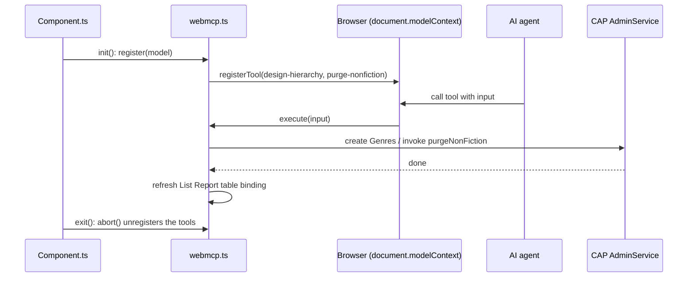
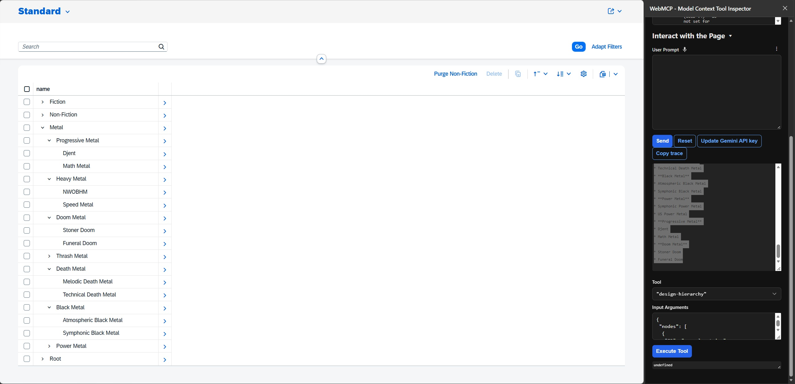

# CAP + UI5 Fiori Elements WebMCP Hierarchy Designer

A demo of [WebMCP](https://webmachinelearning.github.io/webmcp/) in a SAP Fiori elements (UI5) List Report. The app exposes tools to the browser via `document.modelContext`, so an in-browser AI agent can design and edit a hierarchy of music genres by calling them.

## What it does

- A CAP backend serves a hierarchical `Genres` entity (`parent` / `children`, annotated `@hierarchy`).
- A Fiori elements List Report (`app/browse-genres`) shows the genres as a tree.
- The UI5 component registers two WebMCP tools when the browser supports WebMCP:

Tool | Purpose
---------|----------
`design-hierarchy` | Creates a new root with nested children from a flat list of nodes (`ID`, `parent_ID`, `name`)
`purge-nonfiction` | Calls the unbound CAP action `purgeNonFiction` to delete the non-fiction entries

After a tool runs, the List Report table's list binding is refreshed so the UI shows the result.

## Project layout

File or Folder | Purpose
---------|----------
`app/browse-genres/` | Fiori elements List Report (TypeScript UI5 app)
`app/browse-genres/webapp/webmcp.ts` | WebMCP tool registration (`design-hierarchy`, `purge-nonfiction`)
`app/browse-genres/webapp/Component.ts` | Registers the tools in `init()` and aborts them in `exit()`
`db/schema.cds` | `Genres` domain model (hierarchy via `parent` association)
`db/data/` | Sample genre data (CSV)
`srv/admin-service.cds` | `AdminService` with the `Genres` projection and `purgeNonFiction` action
`srv/admin-service.js` | Handler for `purgeNonFiction`

## How WebMCP is enabled

Only two files of the standard Fiori elements app were changed or added.

1. **`webapp/webmcp.ts` (new)**: `WebMCPController.register(model)` does the work.
   - It returns `null` if `document.modelContext.registerTool` is missing, so browsers without WebMCP are unaffected.
   - Otherwise it calls `registerTool()` once per tool, with a name, description, optional `inputSchema` and an async `execute` callback, and returns an `AbortController`. All tools share its signal.
   - `design-hierarchy` creates the nodes with `ODataListBinding.create()` and waits for each `created()` promise. `purge-nonfiction` invokes the unbound action through `bindContext("/purgeNonFiction(...)")`.
   - After either tool, `refreshListReport()` looks up the List Report table by its global ID and refreshes its own row binding. A new `model.bindList()` would not work here, because it creates a separate binding that the table doesn't use.
   - `import type {} from "webmcp-types"` adds the typings for `document.modelContext`.
2. **`webapp/Component.ts` (changed)**: `init()` calls `WebMCPController.register(this.getModel())` after `super.init()` and keeps the returned controller. `exit()` calls `abort()` on it, which unregisters the tools when the app is destroyed.



## Prerequisites

- Node.js and npm
- A browser with WebMCP support (`document.modelContext`), or the WebMCP Inspector extension, which can call the registered tools and drive them with an AI. If WebMCP is unavailable, the app still runs and registers no tools.

## Run it

```sh
npm install
npm run watch-browse-genres
```

This runs `cds watch` and opens the app at `browsegenres/index.html`.

## Try it

1. Open the app and the WebMCP Inspector (or any WebMCP client).
2. Confirm that `design-hierarchy` and `purge-nonfiction` are listed.
3. Ask the agent to design a hierarchy, or call a tool directly with the sample input below.

### Sample prompt

```text
Can you design a new hierarchy (one new root) for Music genres: root is "Metal" music, please suggest the sub-genres (children) and sub-sub-genres (grandchildren). Use design-hierarchy tool to create it
```

<details>
<summary>Result and transcript</summary>



> **User prompt:** "Can you design a new hierarchy (one new root) for Music genres: root is "Metal" music, please suggest the sub-genres (children) and sub-sub-genres (grandchildren). Use design-hierarchy tool to create it"
>
> **AI calling tool** `design-hierarchy` with:
>
> ```json
> {"nodes":[{"name":"Metal","ID":"a1b2c3d4-e5f6-4a7b-8c9d-0123456789ab"},{"name":"Heavy Metal","ID":"b2c3d4e5-f6a7-4b8c-9d0e-123456789abc","parent_ID":"a1b2c3d4-e5f6-4a7b-8c9d-0123456789ab"},{"name":"Thrash Metal","ID":"c3d4e5f6-a7b8-4c9d-0e1f-23456789abcd","parent_ID":"a1b2c3d4-e5f6-4a7b-8c9d-0123456789ab"},{"ID":"d4e5f6a7-b8c9-4d0e-1f2a-3456789abcde","parent_ID":"a1b2c3d4-e5f6-4a7b-8c9d-0123456789ab","name":"Death Metal"},{"ID":"e5f6a7b8-c9d0-4e1f-2a3b-456789abcdef","name":"Black Metal","parent_ID":"a1b2c3d4-e5f6-4a7b-8c9d-0123456789ab"},{"ID":"f6a7b8c9-d0e1-4f2a-3b4c-56789abcdef0","name":"Power Metal","parent_ID":"a1b2c3d4-e5f6-4a7b-8c9d-0123456789ab"},{"ID":"a7b8c9d0-e1f2-4a3b-4c5d-6789abcdef01","name":"Progressive Metal","parent_ID":"a1b2c3d4-e5f6-4a7b-8c9d-0123456789ab"},{"ID":"b8c9d0e1-f2a3-4b4c-5d6e-789abcdef012","parent_ID":"a1b2c3d4-e5f6-4a7b-8c9d-0123456789ab","name":"Doom Metal"},{"name":"NWOBHM","ID":"c9d0e1f2-a3b4-4c5d-6e7f-89abcdef0123","parent_ID":"b2c3d4e5-f6a7-4b8c-9d0e-123456789abc"},{"name":"Speed Metal","parent_ID":"b2c3d4e5-f6a7-4b8c-9d0e-123456789abc","ID":"d0e1f2a3-b4c5-4d6e-7f8a-9abcdef01234"},{"name":"Crossover Thrash","parent_ID":"c3d4e5f6-a7b8-4c9d-0e1f-23456789abcd","ID":"e1f2a3b4-c5d6-4e7f-8a9b-abcdef012345"},{"name":"Technical Thrash","parent_ID":"c3d4e5f6-a7b8-4c9d-0e1f-23456789abcd","ID":"f2a3b4c5-d6e7-4f8a-9b0c-bcdef0123456"},{"name":"Melodic Death Metal","parent_ID":"d4e5f6a7-b8c9-4d0e-1f2a-3456789abcde","ID":"a3b4c5d6-e7f8-4a9b-0c1d-cdef01234567"},{"parent_ID":"d4e5f6a7-b8c9-4d0e-1f2a-3456789abcde","ID":"b4c5d6e7-f8a9-4b0c-1d2e-def012345678","name":"Technical Death Metal"},{"parent_ID":"e5f6a7b8-c9d0-4e1f-2a3b-456789abcdef","name":"Atmospheric Black Metal","ID":"c5d6e7f8-a9b0-4c1d-2e3f-ef0123456789"},{"ID":"d6e7f8a9-b0c1-4d2e-3f4a-f0123456789a","parent_ID":"e5f6a7b8-c9d0-4e1f-2a3b-456789abcdef","name":"Symphonic Black Metal"},{"name":"Symphonic Power Metal","ID":"e7f8a9b0-c1d2-4e3f-4a5b-0123456789ab","parent_ID":"f6a7b8c9-d0e1-4f2a-3b4c-56789abcdef0"},{"parent_ID":"f6a7b8c9-d0e1-4f2a-3b4c-56789abcdef0","name":"US Power Metal","ID":"f8a9b0c1-d2e3-4f4a-5b6c-123456789abc"},{"name":"Djent","ID":"a9b0c1d2-e3f4-4a5b-6c7d-23456789abcd","parent_ID":"a7b8c9d0-e1f2-4a3b-4c5d-6789abcdef01"},{"ID":"b0c1d2e3-f4a5-4b6c-7d8e-3456789abcde","parent_ID":"a7b8c9d0-e1f2-4a3b-4c5d-6789abcdef01","name":"Math Metal"},{"name":"Stoner Doom","ID":"c1d2e3f4-a5b6-4c7d-8e9f-456789abcdef","parent_ID":"b8c9d0e1-f2a3-4b4c-5d6e-789abcdef012"},{"parent_ID":"b8c9d0e1-f2a3-4b4c-5d6e-789abcdef012","ID":"d2e3f4a5-b6c7-4d8e-9f0a-56789abcdef0","name":"Funeral Doom"}]}
> ```
>
> **Tool** `design-hierarchy` **result:** ok
>
> **AI result:** I have created the new hierarchy for **Metal** music with its sub-genres (children) and sub-sub-genres (grandchildren):
>
> ### **Hierarchy Structure**
>
> * **Metal** (Root)
>   * **Heavy Metal**
>     * NWOBHM (New Wave of British Heavy Metal)
>     * Speed Metal
>   * **Thrash Metal**
>     * Crossover Thrash
>     * Technical Thrash
>   * **Death Metal**
>     * Melodic Death Metal
>     * Technical Death Metal
>   * **Black Metal**
>     * Atmospheric Black Metal
>     * Symphonic Black Metal
>   * **Power Metal**
>     * Symphonic Power Metal
>     * US Power Metal
>   * **Progressive Metal**
>     * Djent
>     * Math Metal
>   * **Doom Metal**
>     * Stoner Doom
>     * Funeral Doom

</details>

### Sample input for `design-hierarchy`

```json
{
  "nodes": [
    {
      "ID": "dd4de802-e148-4607-9dbb-243e2ec4e980",
      "name": "Root"
    },
    {
      "ID": "3a49edf7-9451-4738-abe6-90b909013e41",
      "parent_ID": "dd4de802-e148-4607-9dbb-243e2ec4e980",
      "name": "Child"
    },
    {
      "ID": "353abba6-51a2-4beb-923c-9c9d7213b769",
      "parent_ID": "3a49edf7-9451-4738-abe6-90b909013e41",
      "name": "Grandchild"
    }
  ]
}
```

Notes:

- `ID` values are UUID v4. Omit `parent_ID` for root nodes.
- The nodes are wrapped in a `nodes` object because the WebMCP Inspector extension's AI cannot currently handle a top-level array input.

### `purge-nonfiction`

Takes no input. It deletes every genre whose ID starts with `2` (the non-fiction branch of the sample data) and refreshes the list.

## Learn more

- CAP: <https://cap.cloud.sap>
- SAP Fiori elements: <https://ui5.sap.com/#/topic/03265b0408e2432c9571d6b3feb6b1fd>
