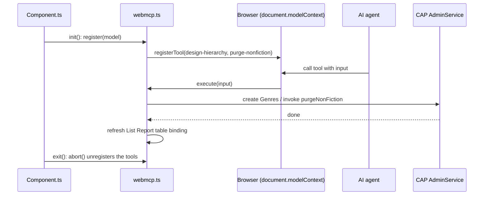

# CAP + UI5 Fiori Elements WebMCP Hierarchy Designer

A demo of [WebMCP](https://webmachinelearning.github.io/webmcp/) in a SAP Fiori elements (UI5) List Report. The app exposes tools to the browser via `document.modelContext`, so an in-browser AI agent can design and edit a hierarchy of music genres by calling them.

## What it does

- A CAP backend serves a hierarchical `Genres` entity (`parent` / `children`, annotated `@hierarchy`).
- A Fiori elements List Report (`app/browse-genres`) shows the genres as a tree.
- The UI5 component registers two WebMCP tools when the browser supports WebMCP:

Tool | Purpose
---------|----------
`design-hierarchy` | Creates a new root with nested children from a flat list of nodes (`ID`, `parent_ID`, `name`)
`purge-nonfiction` | Calls the unbound CAP action `purgeNonFiction` to delete the non-fiction entries

After a tool runs, the List Report table's list binding is refreshed so the UI shows the result.

## Project layout

File or Folder | Purpose
---------|----------
`app/browse-genres/` | Fiori elements List Report (TypeScript UI5 app)
`app/browse-genres/webapp/webmcp.ts` | WebMCP tool registration (`design-hierarchy`, `purge-nonfiction`)
`app/browse-genres/webapp/Component.ts` | Registers the tools in `init()` and aborts them in `exit()`
`db/schema.cds` | `Genres` domain model (hierarchy via `parent` association)
`db/data/` | Sample genre data (CSV)
`srv/admin-service.cds` | `AdminService` with the `Genres` projection and `purgeNonFiction` action
`srv/admin-service.js` | Handler for `purgeNonFiction`

## How WebMCP is enabled

Only two files of the standard Fiori elements app were changed or added.

1. **`webapp/webmcp.ts` (new)**: `WebMCPController.register(model)` does the work.
   - It returns `null` if `document.modelContext.registerTool` is missing, so browsers without WebMCP are unaffected.
   - Otherwise it calls `registerTool()` once per tool, with a name, description, optional `inputSchema` and an async `execute` callback, and returns an `AbortController`. All tools share its signal.
   - `design-hierarchy` creates the nodes with `ODataListBinding.create()` and waits for each `created()` promise. `purge-nonfiction` invokes the unbound action through `bindContext("/purgeNonFiction(...)")`.
   - After either tool, `refreshListReport()` looks up the List Report table by its global ID and refreshes its own row binding. A new `model.bindList()` would not work here, because it creates a separate binding that the table doesn't use.
   - `import type {} from "webmcp-types"` adds the typings for `document.modelContext`.
2. **`webapp/Component.ts` (changed)**: `init()` calls `WebMCPController.register(this.getModel())` after `super.init()` and keeps the returned controller. `exit()` calls `abort()` on it, which unregisters the tools when the app is destroyed.



## Prerequisites

- Node.js and npm
- A browser with WebMCP support (`document.modelContext`), or the WebMCP Inspector extension, which can call the registered tools and drive them with an AI. If WebMCP is unavailable, the app still runs and registers no tools.

## Run it

```sh
npm install
npm run watch-browse-genres
```

This runs `cds watch` and opens the app at `browsegenres/index.html`.

## Try it

1. Open the app and the WebMCP Inspector (or any WebMCP client).
2. Confirm that `design-hierarchy` and `purge-nonfiction` are listed.
3. Ask the agent to design a hierarchy, or call a tool directly with the sample input below.

### Sample prompt

```text
Can you design a new hierarchy (one new root) for Music genres: root is "Metal" music, please suggest the sub-genres (children) and sub-sub-genres (grandchildren). Use design-hierarchy tool to create it
```

### Sample input for `design-hierarchy`

```json
{
  "nodes": [
    {
      "ID": "dd4de802-e148-4607-9dbb-243e2ec4e980",
      "name": "Root"
    },
    {
      "ID": "3a49edf7-9451-4738-abe6-90b909013e41",
      "parent_ID": "dd4de802-e148-4607-9dbb-243e2ec4e980",
      "name": "Child"
    },
    {
      "ID": "353abba6-51a2-4beb-923c-9c9d7213b769",
      "parent_ID": "3a49edf7-9451-4738-abe6-90b909013e41",
      "name": "Grandchild"
    }
  ]
}
```

Notes:

- `ID` values are UUID v4. Omit `parent_ID` for root nodes.
- The nodes are wrapped in a `nodes` object because the WebMCP Inspector extension's AI cannot currently handle a top-level array input.

### `purge-nonfiction`

Takes no input. It deletes every genre whose ID starts with `2` (the non-fiction branch of the sample data) and refreshes the list.

## Learn more

- CAP: <https://cap.cloud.sap>
- SAP Fiori elements: <https://ui5.sap.com/#/topic/03265b0408e2432c9571d6b3feb6b1fd>
